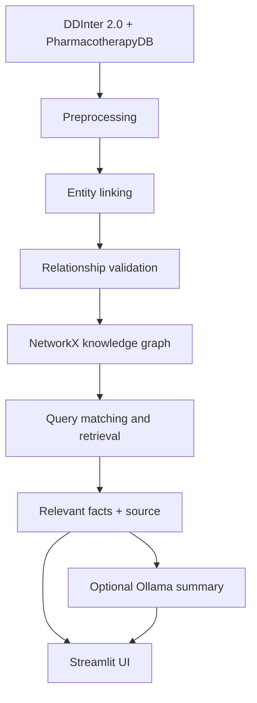

# Medical Knowledge Graph-Based Information Retrieval System — Full Documentation

> For a quick overview, installation, and usage, see [README.md](README.md).
> This file is the long version: the dataset dictionary, module design
> decisions, a milestone-by-milestone build log, bugs found and fixed,
> and the full evaluation results.

## 1. Problem Statement

Medical facts like "which drugs interact" or "which drugs treat which
diseases" are relational by nature. A plain keyword search can't easily
answer "what interacts with Warfarin?" because the answer is a set of
connected entities, not a passage of text.

So I built this as a graph problem instead: model drugs and diseases as a
knowledge graph, and answer relationship queries by retrieving connected
subgraphs. The system retrieves facts and, optionally, summarizes them —
it doesn't ask a language model to recall facts from memory.

**This is not a diagnosis tool.** It retrieves and summarizes existing,
sourced relationships. See [Medical Safety](#12-medical-safety) below.

## 2. Objectives

- Build a knowledge graph of drugs, diseases, and their relationships from
  real, openly available medical data.
- Support natural-language queries like *"What drugs interact with
  Warfarin?"* by matching the query to a graph entity and retrieving its
  1–2 hop neighborhood.
- Keep retrieval (graph traversal) independent of, and prior to, any LLM
  step — the LLM only summarizes what retrieval already found.
- Evaluate retrieval quality (precision/recall/F1) against a manually
  verified query set, and compare it against a plain keyword baseline.

**Outcome:** a user can ask a plain-language question and receive linked,
source-backed facts from the saved graph. When no drug or disease matches,
the system can fall back to BM25 keyword search. It is an information
retrieval prototype, not a diagnosis or treatment recommendation tool.

## 3. Architecture



The knowledge graph is built offline; query-time retrieval only ever runs
against the pre-built graph. A standalone script (`build_graph.py`,
Milestone 4) builds it once and saves it to disk — the Streamlit app just
loads and queries that file, never rebuilding it on request.

## 4. Dataset

I combined two independent, openly downloadable sources. DDInter turned
out to have no disease data at all, so I added PharmacotherapyDB
specifically to cover the drug-disease side — a scope decision made after
inspecting the data, not something I missed going in.

### 4.1 DDInter 2.0 — drug-drug interactions (primary source)

Source: <https://ddinter2.scbdd.com/download/>
Downloaded as 8 CSV files, one per top-level ATC drug category
(`ddinter_downloads_code_{A,B,D,H,L,P,R,V}.csv`), ~222k rows total.

| Column | Type | Description |
|---|---|---|
| `DDInterID_A` | string | DDInter's stable ID for drug A, e.g. `DDInter582` |
| `Drug_A` | string | Name of drug A |
| `DDInterID_B` | string | DDInter's stable ID for drug B |
| `Drug_B` | string | Name of drug B |
| `Level` | string | Interaction severity: `Major`, `Moderate`, `Minor`, `Unknown` |

**Note:** the bulk export has no free-text mechanism field and no disease
information — just the 5 columns above. Richer mechanism text exists on
DDInter's individual interaction pages, but one pair at a time across
222k pages, so scraping wasn't realistic here. `Level` is the only
evidence field this source offers, kept as the `severity` edge attribute.

### 4.2 PharmacotherapyDB 1.0 — drug-disease indications (supplementary source)

Source: <https://github.com/dhimmel/indications> (physician-curated;
601 drugs, 97 diseases, 1,388 rows).

| Column | Type | Description |
|---|---|---|
| `doid_id` | string | Disease Ontology ID, e.g. `DOID:10652` |
| `drugbank_id` | string | DrugBank ID, e.g. `DB00843` |
| `disease` | string | Disease name |
| `drug` | string | Drug name |
| `category` | string | `DM` (disease-modifying), `SYM` (symptomatic), `NOT` (confirmed non-indication) |
| `n_curators` | int | Number of physician curators who confirmed the indication |
| `n_resources` | int | Number of literature resources supporting it |

91% (548/601) of the drugs here also show up in DDInter, so the two
sources connect into one graph instead of sitting as disconnected
islands — `metformin` appears in both, `warfarin` only in DDInter, which
is expected.

### 4.3 Processed schema (output of `src/data_pipeline.py`)

Both sources are normalized to the same flat shape before entity
extraction:

| Column | Meaning |
|---|---|
| `record_id` | Unique ID for provenance, e.g. `ddinter_DDInter582_DDInter725` or `pharmdb_DB00843_DOID:10652` |
| `source_entity` / `target_entity` | Raw entity names (not yet canonicalized) |
| `relationship` | One of the controlled relation types (see below) |
| *(source-specific evidence columns)* | `severity`/`atc_code` for interactions; `indication_category`/`n_curators`/`n_resources` for indications |

Two important cleaning choices:

- Duplicate `(DDInterID_A, DDInterID_B)` pairs across ATC files (~28% of
  raw rows) are dropped, keeping the first occurrence.
- PharmacotherapyDB rows with `category == "NOT"` are dropped entirely —
  these are physician-confirmed *negative* indications, so keeping them
  would assert the opposite of the source.

### 4.4 Controlled relationship vocabulary

| Relationship | Used for |
|---|---|
| `INTERACTS_WITH` | DDInter drug-drug interactions |
| `TREATS` | PharmacotherapyDB drug-disease indications (DM or SYM) |
| `CONTRAINDICATED_IN` | reserved for future structured data |
| `CAUTION_IN` | reserved for future structured data |
| `ASSOCIATED_WITH` | reserved for future/LLM-inferred relations |

Nothing outside this fixed set is ever written to the graph.

## 5. Technology Stack

Python 3.x, Pandas, NetworkX, Scikit-learn, Streamlit, Ollama (optional),
Pydantic, Pyvis for the graph visualization. No Neo4j, vector databases,
LangChain, or agent frameworks — kept lightweight and easy to explain
end-to-end.

## 6. Project Structure

```
medical-graph-ir/
├── data/
│   ├── raw/            DDInter CSVs + PharmacotherapyDB TSV (downloaded, gitignored)
│   ├── processed/       Cleaned tables, entities, and relationships
│   └── graph/            Saved NetworkX graph (build_graph.py output)
├── src/
│   ├── config.py         All paths & tunable constants
│   ├── data_pipeline.py   Loads, cleans, and links the source records
│   ├── graph_pipeline.py  Validates relationships and builds/saves the graph
│   ├── retrieval.py           Query matching + 1-2 hop ranked retrieval (the core IR engine)
│   ├── bm25_baseline.py       BM25 lexical baseline (for comparison, Milestone 7)
│   ├── fallback_retrieval.py  Graph-first retrieval with a BM25 lexical fallback
│   └── answer_generator.py    Optional Ollama summary layer over retrieved facts
├── evaluation/
│   ├── build_test_queries.py  Derives test_queries.csv ground truth from the real graph
│   ├── test_queries.csv       30 manually-curated queries with graph-derived expected answers
│   ├── evaluate.py            Graph-derived benchmark (graph vs BM25), P/R/F1/P@K/timing
│   ├── build_judgment_pool.py Pools graph + BM25 top-20 candidates for human judgment
│   ├── draft_judgments.py     Rule-based draft relevance grades for the pool
│   ├── evaluate_judgments.py  Scores rankings against the human-judged pool
│   ├── relevance_metrics.py   P@K / Recall@K / MAP@K / graded NDCG@K
│   └── results_*.csv          Generated result tables
├── build_graph.py         Standalone script: runs the full pipeline, saves the graph
├── app.py                 Streamlit UI (search, graph viz, evidence table, optional AI summary)
├── requirements.txt
└── README.md
```

## 7. Installation

```bash
pip install -r requirements.txt
```

Raw data is already in `data/raw/`. To re-download from scratch:

```bash
# DDInter 2.0 (8 files)
for code in A B D H L P R V; do
  curl -o data/raw/ddinter_downloads_code_${code}.csv \
    https://ddinter2.scbdd.com/static/media/download/ddinter_downloads_code_${code}.csv
done

# PharmacotherapyDB
curl -o data/raw/pharmacotherapydb_indications.tsv \
  https://raw.githubusercontent.com/dhimmel/indications/gh-pages/catalog/indications.tsv
```

## 8. Building and querying the graph

Run one command to load and clean the source data, link names, validate
relationships, and save the graph:

```bash
python build_graph.py                # full ~222k-row dataset (~25s)
python build_graph.py --max-rows 2000 # quick full-pipeline dry run
```

Use `--max-rows` for a quick sample build. Leave it out to use the full
dataset. The standalone build is separate from the app, so Streamlit only
loads the saved graph and does not rebuild it on each page load.

### 8.1 Entity table (created by `src/data_pipeline.py`)

| Column | Meaning |
|---|---|
| `entity_id` | Stable graph node key, e.g. `drug::metformin`, `disease::alzheimer_s_disease` |
| `canonical_name` | Most frequently seen raw casing/variant, used for display |
| `entity_type` | `DRUG` or `DISEASE` |
| `normalized_name` | Lowercased, whitespace-collapsed join key (punctuation preserved - see module docstring for why) |
| `aliases` | All distinct raw name variants seen, pipe-separated |
| `mention_count` | How many records reference this entity (a simple support/frequency signal used later in ranking) |

Normalization is deliberately minimal: lowercase plus whitespace collapse,
nothing more. Punctuation stays untouched because it can carry real
meaning here — `Amphotericin B (liposomal)` and `Amphotericin B
(cholesteryl sulfate)` are different formulations with different
interaction profiles, not two spellings of the same thing. A naive
"strip all punctuation" pass would have silently merged them into one
wrong node; I only caught this by looking at the raw data first.

This step is also what merges the two data sources into one graph:
`metformin` from DDInter and from PharmacotherapyDB both resolve to the
same `drug::metformin` node, so its interactions and indications are
reachable from a single entity.

### 8.2 Relationship validation (in `src/graph_pipeline.py`)

Every row already carries an explicit, reliable relationship (assigned
in `data_pipeline.py`), so extraction is purely structured: each row
becomes a Pydantic `Relation` object (`source_entity_id, relationship,
target_entity_id, record_id, evidence, attributes`), validated against
`config.VALID_RELATIONS`. No LLM touches this path — a dataset-provided
relationship always wins over an LLM's guess.

An optional `extract_relation_with_llm()` path also exists for inferring
a relationship from free text via Ollama, constrained to the same
vocabulary and validated the same way. It's not wired into the current
pipeline, not for any Ollama setup reason, but because neither data
source has a free-text field to run it on (see Limitations). The code is
ready for whenever one gets added — a different Ollama use case from the
answer-generation stage, which *is* exercised end-to-end (section 9.2).

### 8.3 Knowledge graph (built by `src/graph_pipeline.py` / `build_graph.py`)

A single `networkx.DiGraph`, saved with plain Python `pickle` (NetworkX
3.x dropped its own `write_gpickle`/`read_gpickle`) to
`data/graph/medical_kg.pkl`. Built once by `build_graph.py`; the
Streamlit app only ever loads it.

On the full dataset: 2,075 nodes (1,984 drugs, 91 diseases), 161,380
edges, 0 isolated nodes, built in ~25s.

Node attributes: `entity_id`, `canonical_name`, `entity_type`, `aliases`
(list), `mention_count`. Edge attributes: `relationship`, `record_id`
(for provenance), `evidence` (human-readable source text), plus
source-specific fields (`severity`/`atc_code` for `INTERACTS_WITH`;
`indication_category`/`n_curators`/`n_resources` for `TREATS`).

**Edge direction for `INTERACTS_WITH`.** Drug-drug interactions are
conceptually symmetric, but DDInter records each one as a single row in
one direction only — I checked, no pair ever appears both ways. Rather
than fabricating a reverse edge with a made-up record ID, I store exactly
one edge per source row, keeping provenance a clean 1:1 map. The
consequence: retrieval has to check both outgoing and incoming edges when
expanding `INTERACTS_WITH`. `TREATS` stays purely directional
(drug → disease), since that relationship isn't symmetric.

Also worth flagging: DDInter uses generic/INN drug names, not brand
names — `Aspirin` isn't a node, `Acetylsalicylic acid` is. Exact-string
matching alone would miss common brand-name queries, part of why fuzzy
and partial matching matter here.

### 8.4 Retrieval engine (`src/retrieval.py`)

The core IR component. `retrieve_relationships(query, G, index)` runs
the full pipeline: normalize, match the query to an entity through four
transparent tiers (EXACT → SUBSTRING → PARTIAL → FUZZY), do 1-hop
retrieval, optionally expand to 2-hop (seeded from only the top
`TWO_HOP_MAX_SEED_NODES` 1-hop neighbors so a high-degree node like
Warfarin doesn't blow up the subgraph), consolidate duplicates, rank by
hop distance then severity/curator-support (no PageRank, no learned
model), and return the top-K.

`build_entity_index()`/`load_retrieval_engine()` build the alias lookup
and load the graph once, so `retrieve_relationships()` itself does no
disk I/O and repeated queries stay fast.

```bash
python -m src.retrieval
```

Real results from the full graph:

| Query | Matched entity | Result |
|---|---|---|
| "What drugs interact with Warfarin?" | Warfarin (SUBSTRING) | 20 top-ranked `INTERACTS_WITH` facts, ranked by severity, in ~60ms |
| "What diseases are associated with Metformin?" | Metformin (SUBSTRING) | 3 direct `TREATS` facts + 2-hop drugs sharing the same disease, in <1ms |
| "What drugs are related to Diabetes?" | *ambiguous* | Best guess: gestational diabetes; candidates also surface type 1 and type 2 diabetes mellitus - see below |
| "Worfarin" (typo) | Warfarin (FUZZY, 0.875) | correctly recovers from the typo |
| "xyzabc123" | none | empty result, no crash |

I hit a real bug testing the brief's own example queries: "What drugs are
related to Diabetes?" returned no match. Diabetes is modeled as three
separate entities (`gestational diabetes`, `type 1`, `type 2`), and my
matcher only checked whether the query *contained* a full known name,
never the reverse — a short word sitting *inside* a longer name. I added
a PARTIAL tier for that, then found a second issue: it silently picked
the shortest containing name and hid the other two. Since all three are
real, distinct entities, that's genuine ambiguity, not a bug to paper
over, so PARTIAL/FUZZY matches now surface every alternative as a
`candidate_match` instead of guessing.

One scope limitation: matching only finds the single best entity in a
query. A two-entity query like "connections between Metformin and kidney
disease" resolves to Metformin's own neighborhood, not a path search —
there's also no `disease::kidney_disease` node anyway (the data has
`chronic kidney failure` and `kidney cancer` as separate entities).
Path-finding between two named entities would be a reasonable future
extension, but it isn't part of the Milestone 5 API the brief specifies.

### 8.5 BM25 lexical baseline (`src/bm25_baseline.py`)

The non-graph IR baseline graph retrieval gets compared against — the
reason this is an IR project and not just "a graph with a search box."
Each relation record is flattened into a bag-of-words document
(`source_entity + relationship + target_entity + evidence`) and indexed
with Okapi BM25, which weights rare/distinctive terms higher than common
ones and normalizes for document length. No concept of connected entities
or relationship type — purely term overlap.

```bash
python -m src.bm25_baseline
```

Index build (over all 161,380 records) is one-time; per-query search after
that is a few milliseconds.

The comparison shows exactly what I expected. For `"What diseases are
associated with Metformin?"`, the baseline's top results are dominated by
`INTERACTS_WITH` records — zero `TREATS`. "Metformin" is a high-IDF term
that co-occurs with hundreds of interaction rows, drowning out the 3 real
disease-treatment facts. Graph retrieval gets this right because it
filters by relationship type and traverses the graph structurally, not
just vocabulary. For `"What drugs interact with Warfarin?"`, where the
dominant term is rare and distinctive on its own, the baseline does
fine — the gap only opens up where *relationship type*, not just entity
name, determines relevance. Milestone 7 turns this into a measured
Precision/Recall/F1 comparison instead of eyeballed examples.

### 8.6 Graph-first retrieval with lexical fallback (`src/fallback_retrieval.py`)

The app's default retrieval mode. It is a policy over the two methods, not a
third scoring scheme: `retrieve_with_fallback()` runs graph retrieval first
and returns its result whenever an entity matched; only when entity matching
finds nothing does it fall back to BM25 over the raw query text. No scores
are blended, so every result is attributable to exactly one method and the
behavior is easy to explain.

```bash
python -m src.fallback_retrieval
```

This replaces an earlier score-fusion (hybrid) approach — a weighted blend of
TF-IDF and graph scores. The fallback is simpler to justify and matches how
retrieval systems commonly behave: use the structured index when it can
resolve the query, and lean on lexical search as the safety net when it
can't. A query that matches an entity always uses the graph result, even if
that entity has few neighbors; a query like `xyzabc123` (no entity) gets BM25
ranking instead of an empty page. `RetrievalResult.used_lexical_fallback`
flags which path was taken so the UI can say so.

It is deliberately not part of the benchmark: every query in
`test_queries.csv` / `judgment_queries.csv` matches an entity, so the
fallback path never triggers there and its scores would be identical to pure
graph retrieval.

## 9. Evaluation Methodology

`evaluation/test_queries.csv` holds 30 manually-curated queries. I picked
*which* real entities to ask about by hand — a mix of high/low-degree
drugs, both relationship directions, unfiltered "tell me about X"
queries, 2 typo-recovery cases, and 2 negative/unknown-entity cases. The
*expected answers*, though, were computed directly from the saved graph
by `evaluation/build_test_queries.py`, not typed by hand, so ground truth
can't drift from what the graph actually contains.

`evaluation/evaluate.py` runs the graph retriever (`max_hops=1`, matching
how ground truth is defined) and the BM25 baseline against every query,
extracts "the other entity" in each result, and computes
Precision / Recall / F1 / P@5 / P@10 / retrieval time, then
macro-averages.

Actual measured results, `evaluation/results_summary.csv`, 30 queries,
full dataset:

| Method | Precision | Recall | F1 | Precision@5 | Precision@10 | Avg. retrieval time |
|---|---|---|---|---|---|---|
| Graph retrieval | 1.000 | 0.699 | 0.717 | 1.000 | 1.000 | 2.0ms |
| BM25 baseline | 0.594 | 0.465 | 0.359 | 0.647 | 0.607 | 2.6ms |

Graph wins on F1 for 13/30 queries and ties on 17 (mostly the 2
negative-entity cases, plus queries where the entity name is distinctive
enough that lexical search does fine on its own, e.g. "Doripenem").
BM25 never wins outright. I'm reporting it this way rather than
"graph wins every time" because the tie breakdown is more useful: it
shows exactly when graph's structural filtering matters (real
relationship-type ambiguity) versus when it doesn't (unambiguous terms).

Two illustrative results:
- `"What diseases does Metformin treat?"` — graph: 1.0/1.0/1.0. BM25:
  0.0/0.0/0.0 — none of its top-20 were among the 3 correct diseases;
  term overlap on "metformin" surfaced only `INTERACTS_WITH` records.
- `"What drugs treat Kawasaki disease?"` — graph: 1.0/1.0/1.0. BM25:
  precision 0.04 — finds the one correct drug but buries it among 24
  loosely term-matched records.

Graph's precision is exactly 1.0 by construction for a 1-hop query, since
every fact came from a real edge. Recall of 0.699 is just
`TOP_K_RESULTS=20` truncating high-degree nodes like Warfarin (864
interactions) — an expected trade-off, not a bug.

**One real bug turned up specifically because I ran this evaluation.**
The typo query `"What drugs interact with Worfarin?"` matched
"Polyethylene glycol (3350 with electrolytes)" instead of Warfarin, and
the negative test `"...Zzznonexistentdrug?"` matched the same wrong
entity instead of finding nothing. Root cause: the filler word "with" in
the query literally appears inside that drug's parenthetical qualifier,
and the PARTIAL tier tried it before ever reaching "Worfarin." Fixed by
stripping a small query-stopword list before generating match candidates
for the PARTIAL/FUZZY tiers (`_QUERY_STOPWORDS`). The numbers above are
from the corrected code.

```bash
python evaluation/build_test_queries.py   # regenerate ground truth from the current graph
python evaluation/evaluate.py             # run the comparison, print + save results
```

### 9.1 Independent human-judgment evaluation

The graph-derived numbers above are structurally favorable to graph
retrieval: their expected entities are taken from the same graph being
searched, so a 1-hop query scores precision 1.0 by construction. They
measure neighbor reproduction, not whether a retrieved record is relevant
to a user.

To answer the relevance question honestly, `evaluation/` also ships a
pooled human-judgment workflow:

```bash
python evaluation/build_judgment_pool.py   # pool graph + BM25 top-20 per query
python evaluation/draft_judgments.py       # rule-based draft grades to review
python evaluation/evaluate_judgments.py    # score rankings against the grades
```

`build_judgment_pool.py` runs graph and BM25 retrieval over the 30 queries
in `judgment_queries.csv`, collects the union of their top-20 candidates
into `judgment_candidates.csv`, and deterministically shuffles the order
per query so assessor bias from method/rank provenance is reduced.
`draft_judgments.py` fills a conservative 0/1/2 suggestion per candidate
(0 irrelevant, 1 related, 2 directly answers); every row is then reviewed
by hand. `evaluate_judgments.py` refuses to run until every row has a
relevance grade, then reports P@5/10/20, pooled Recall@20, MAP@20 and
graded NDCG@5/10 via `relevance_metrics.py`. Recall is relative to
relevant records found in this top-20-per-method pool, not exhaustive
relevance over the corpus.

Measured on the 30-query pooled set:

| Method | P@5 | P@20 | Recall@20 | MAP@20 | NDCG@10 |
|---|---|---|---|---|---|
| Graph retrieval | 0.807 | 0.573 | 0.648 | 0.865 | 0.959 |
| BM25 baseline | 0.780 | 0.670 | 0.690 | 0.933 | 0.798 |

Against independent judgments the two are close and neither dominates:
BM25 leads on pooled MAP@20 and Recall@20, graph leads on NDCG and P@5.
That is the useful result — it shows the graph-derived benchmark's
apparent graph superiority does not survive an independent relevance
measure, which is exactly why both tracks are reported.

### 9.2 Optional Ollama summary (`src/answer_generator.py`)

The last, strictly optional stage. `generate_answer(query, result)` takes
an already-computed `RetrievalResult` and asks a local Ollama model to
summarize it — retrieval and ranking are fully done first, so a bad or
missing LLM can change how the answer is phrased but never which facts
were found.

The prompt gives the model retrieved facts as numbered context, each
labeled `[direct]` (1-hop) or `[2-hop]` (extra context only) — added
after noticing the first version mixed all hops together with no signal
about which facts actually answer the question, risking the model
over-weighting tangential 2-hop facts. It also tells the model to use
only the listed facts, flag when they don't fully answer the question,
avoid diagnostic/prescriptive language, and stay concise. A lightweight
keyword scan logs a warning if the output looks prescriptive anyway —
best-effort, not a hard guarantee.

`generate_answer()` never raises. It returns `ollama_available=False`
with an explanatory note for every failure mode: no facts to summarize,
`ollama` not installed, the service unreachable, the model not pulled, or
an empty response. The caller always has `result.facts` regardless, so
the app works with or without Ollama.

```bash
python -m src.answer_generator
```

Ollama wasn't installed in my dev environment at first, so I verified the
"package not installed" fallback before anything else:
```json
{"summary": null, "facts_used": 20, "ollama_available": false,
 "note": "Ollama is not installed; showing retrieved facts only."}
```
That surfaced a gotcha worth noting: having the Ollama service running
(`localhost:11434` reachable, model pulled) isn't the same as having the
`ollama` *Python package* installed in the environment running the app.
That's exactly what happened here — the service and `llama3.2` were
confirmed live, but `generate_answer()` kept reporting "not installed"
until I pip-installed `ollama` into the same interpreter running
Streamlit.

After fixing that, live generation worked end-to-end for real. For "What
diseases does Metformin treat?" (20 retrieved facts, 3 direct + 17
2-hop):
> "The retrieved records indicate that Metformin treats type 2 diabetes
> mellitus, metabolic syndrome X, and polycystic ovary syndrome."

It correctly used only the 3 `[direct]` facts and ignored the 17 `[2-hop]`
facts about other drugs — exactly what the hop-labeling was meant to
achieve. Also confirmed via `AppTest` that the AI Summary section shows a
real `st.success` box with generated text instead of the fallback
caption.

### 9.3 Streamlit app (`app.py`)

```bash
streamlit run app.py
```

The graph loads once via `st.cache_resource`. A nav radio at the top of
the sidebar (`🔎 Search / 📊 Evaluation / ℹ️ About`) switches between
three views, all in one `app.py` file — no `pages/` directory needed at
this size.

**🔎 Search** — disclaimer banner, sidebar with live graph stats, an
auto-adaptive hops toggle (below), a `Retrieval Method: Auto / Graph / BM25`
selector, an "enable AI summary" checkbox, then a search form. Results
flow: Matched Entity → Retrieved Relationships → Knowledge Graph
(interactive pyvis) → Retrieved Evidence (sortable table) → optional AI
Summary.

**📊 Evaluation** — reads the CSVs `evaluate.py` already saved rather
than re-running the ~30s evaluation per page view. Four sections: (1) an
overall metrics table, (2) a bar chart grouped by method (chosen
deliberately — "which method wins" reads faster than "which metric is
highest"), (3) a retrieval-speed chart, and (4) the independent
human-judgment table, followed by the full per-query tables in expanders.
The page states plainly that the graph-derived benchmark is structurally
favorable to graph retrieval and points at the human-judgment numbers for
the relevance question. Degrades gracefully if `evaluate.py` hasn't been
run yet.

**ℹ️ About** — a short static summary (what it is, data sources,
pipeline, tech stack, the disclaimer again) for anyone who lands on the
app without reading this file first.

One accepted trade-off: navigating away from Search and back clears the
typed query and results, since Streamlit only persists a widget's state
while it's still rendered every run. Left as-is on purpose rather than
adding `st.session_state` bookkeeping for a convenience-only fix.

**Auto-adaptive hops (on by default).** Instead of a fixed manual
`max_hops` toggle, `retrieve_relationships(..., adaptive_hops=True)`
picks the hop depth from the matched entity's own connection count: if
it already has `top_k` or more direct connections, 2-hop expansion is
skipped (hop=1 always outranks hop=2 anyway, so 2-hop rarely surfaces at
that point, and skipping saves time); below that, 2-hop runs as usual for
context. Verified directly: Warfarin (864 connections) auto-picks 1 hop,
Doripenem (4 connections) auto-picks 2 — shown to the user via a caption,
not decided silently. A manual override is still available, and the
parameter defaults to off so `evaluate.py` and other callers are
unaffected.

**Hybrid retrieval was evaluated, then dropped.** An earlier version
fused TF-IDF and graph scores (alpha/beta weighted; the
`hybrid_retrieval` module and its weight sweep were since removed). It
never beat pure graph on this dataset — every metric moved toward
graph's as the graph weight rose — so both the module and its UI control
were cut rather than kept for a null result, leaving BM25 as the single
lexical baseline.

The graph visualization is built directly from `result.facts`, not a
full induced subgraph, which would also draw incidental edges between
retrieved nodes that weren't actually part of what got retrieved. Every
edge drawn matches a row in the evidence table.

I didn't have a browser tool for most of this project, so I tested with
Streamlit's `AppTest` API instead — it runs the real app script and
simulates actual widget interactions headlessly, which is a stronger
check than eyeballing a screenshot since it inspects the rendered element
tree and catches exceptions directly:

- Warfarin query: 0 exceptions, all 5 subheaders rendered, matched entity
  and severities correct. AI Summary correctly showed the "Ollama not
  installed" caption at the time, and a real `st.success` box after
  Ollama was set up.
- No-match / empty / ambiguous queries: all handled with the correct
  messages, 0 exceptions.
- Manual `max_hops=1`: confirmed the results table's `Hop` column
  actually stayed capped at 1.
- Auto-adaptive hops: confirmed Warfarin's table only has `Hop=1` rows
  and Doripenem's has both `Hop=1` and `Hop=2` — the decision is real.
- Caught a minor real issue this way too: `st.dataframe(...,
  use_container_width=True)` triggered a deprecation warning past its
  stated removal date — switched to `width="stretch"`.

Also started the server for real and confirmed it serves on
`localhost:8501` (HTTP 200) — `AppTest` covers correctness, but a real
browser is the only way to see the rendered pyvis graph.

### 9.4 Error handling pass (Milestone 10)

A dedicated pass through every scenario the brief requires, tested with
`AppTest` and, where it mattered, against the real saved graph file
rather than mocks:

| Scenario | Behavior | Verified how |
|---|---|---|
| Unknown medical term | "No matching medical entity was found in the current knowledge graph." | `AppTest`, query `xyzabc123` |
| Empty query | "Please enter a query." | `AppTest`, empty string |
| Whitespace-only query | Same as empty (caught by `.strip()`) | `AppTest`, query `"   "` |
| Ollama not running | App still works; facts shown; plain caption instead of a false success | Real - `ollama` genuinely isn't installed here |
| Missing dataset | Clean `st.error` pointing at `python build_graph.py` | Real - graph file renamed away, tested, restored |
| Invalid graph | Clean `st.error`, points at rebuilding | Real - graph file replaced with garbage bytes, tested, restored, checksummed |
| No relationships found | See below - uncovered a real design gap | `AppTest`, "What diseases does Doripenem treat?" |
| Multiple possible entity matches | `st.info` lists alternatives, best guess still shown | `AppTest`, "Diabetes" query |

Two real fixes came out of this pass, not just confirmations:

1. **Filter-relaxation fallback (`src/retrieval.py`).** Doripenem has
   real data (4 interactions) but zero `TREATS` edges. "What diseases
   does Doripenem treat?" used to infer a `TREATS` filter, find nothing,
   and dead-end — technically correct, but worse than it needed to be
   since the entity has other useful data. Fixed by relaxing the filter
   and showing all relationship types when the inferred one comes back
   empty, flagged via `RetrievalResult.relationship_filter_relaxed` so
   the UI can explain what happened. Re-ran the full evaluation
   afterward to confirm this didn't change any of the 30 scores — it
   doesn't, since every ground-truth query already has real data of its
   expected type.

2. **Corrupted-graph handling (`app.py`).** `except FileNotFoundError:`
   only caught a missing file — a corrupted graph raises
   `pickle.UnpicklingError`, a different type entirely that slipped past
   it and showed Streamlit's raw traceback. Found by deliberately
   replacing the graph file with garbage bytes and watching what
   happened, rather than assuming the clause was broad enough. Fixed
   with a second `except Exception` clause.

Also checked, rather than assumed, that none of the 2,075 canonical
entity names contain markdown-special characters (`*`, `_`, backtick,
`[`, `]`, `#`) that could break `st.markdown()` rendering — scanned
`entities.csv` directly to be sure.

## 10. Limitations

- DDInter's bulk export has no free-text mechanism field, so interaction
  "evidence" is limited to the severity label — richer text would mean
  scraping 222k individual pages, out of scope here.
- Disease coverage is limited to the 97 diseases in PharmacotherapyDB.
- Entity resolution is name-based (normalized string matching), not a
  full medical ontology linker like UMLS or ScispaCy.
- DDInter uses generic/INN drug names (`Acetylsalicylic acid`, not
  `Aspirin`), so a brand-name query without fuzzy matching would miss an
  entity that's actually present.

## 11. Future Improvements

ScispaCy/UMLS-based entity linking, a larger evaluation set, a proper
vector+graph hybrid approach, a Neo4j backend — all deferred until this
lightweight version proved it worked end to end first.

## 12. Medical Safety

This system is an academic information retrieval prototype. Retrieved
information should not be used as a substitute for professional medical
advice.

## Milestone Progress

- [x] **Milestone 1** — Environment, dataset inspection, data loader, preprocessing
- [x] **Milestone 2** — Entity extraction & normalization
- [x] **Milestone 3** — Relation extraction
- [x] **Milestone 4** — Knowledge graph construction
- [x] **Milestone 5** — Graph retrieval engine
- [x] **Milestone 6** — Lexical baseline (BM25)
- [x] **Milestone 7** — Evaluation
- [x] **Milestone 8** — Ollama answer generation
- [x] **Milestone 9** — Streamlit app
- [x] **Milestone 10** — Error handling pass
- [x] **Extension** — Hybrid retrieval (TF-IDF + Graph fusion) — evaluated, never beat pure Graph on this dataset, so removed; BM25 remains the single lexical baseline and the evaluated methods are graph + BM25
- [x] **Extension** — Auto-adaptive hop depth (section 9.3) — picks 1 vs 2 hops per query from the matched entity's connection count, manual override still available
