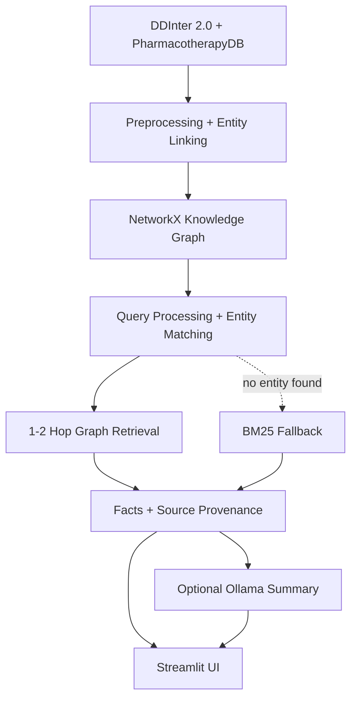

# MedGraphIR: Medical Knowledge Graph Information Retrieval

MedGraphIR models drug-drug interactions and drug-disease relationships as a knowledge graph and answers natural-language queries by matching an entity and retrieving its 1-2 hop neighborhood. Facts are retrieved from the data, not recalled by a language model.

> **Not a diagnosis tool.** It retrieves existing, sourced relationships. See [Medical Safety](#medical-safety).

## How it works



The graph is built once, offline (`build_graph.py`). The app only loads and queries it.

## Features

- **Graph retrieval:** tiered entity matching (exact, substring, partial, fuzzy) with adaptive 1-2 hop traversal, ranked by hop distance and severity/curator support.
- **BM25 fallback:** if no entity matches, the query falls back to lexical search. Each result comes from one method, with no score blending.
- **BM25 baseline** for comparison.
- **Optional local LLM summary** (Ollama), using only the retrieved facts.
- **Streamlit UI** with Search, Evaluation and About pages.

## Quick start

```bash
pip install -r requirements.txt
python build_graph.py     # build the graph once (~25s)
streamlit run app.py      # launch the UI
```

Try: *"What drugs interact with Warfarin?"*

## Evaluation

Two evaluations, with different strengths:

**1. Graph-derived benchmark** (`python evaluation/evaluate.py`): compares results with direct neighbors in the same graph. It checks retrieval behavior but is not independent ground truth, so it favors graph retrieval by construction.

| Method | Precision | Recall | F1 | Avg. time |
|---|---|---|---|---|
| Graph retrieval | 1.000 | 0.699 | 0.717 | 2.0ms |
| BM25 baseline | 0.594 | 0.465 | 0.359 | 2.6ms |

**2. Pooled relevance judgments** (30 queries, top 20 from each method):

```bash
python evaluation/build_judgment_pool.py
python evaluation/draft_judgments.py      # rule-based suggested grades
python evaluation/evaluate_judgments.py
```

Candidates are shuffled per query and method/rank is hidden to reduce bias. Grades start as rule-based suggestions and should be checked by hand before the numbers are cited. Recall is relative to the relevant records found in this pool, not the full corpus.

| Method | P@5 | P@20 | Recall@20 | MAP@20 | NDCG@10 |
|---|---|---|---|---|---|
| Graph retrieval | 0.807 | 0.573 | 0.648 | 0.865 | 0.959 |
| BM25 baseline | 0.780 | 0.670 | 0.690 | 0.933 | 0.798 |

The two methods are close and neither dominates. BM25 leads on MAP@20 and Recall@20, and graph leads on NDCG and P@5. Graph returns fewer than 20 results for some queries, which lowers its P@20.

## Limitations

- Interaction evidence is only a severity label (DDInter's bulk export has no mechanism text).
- Disease coverage is limited to the 97 diseases in PharmacotherapyDB.
- Entity linking is name-based, not a full ontology linker (e.g. brand names may not resolve).
- Queries with two entities resolve to a single entity (multi-entity path search is planned).

## Project structure

```
├── data/          Raw data, processed tables, saved graph
├── src/           Pipeline: preprocessing, entity linking, relation extraction,
│                  graph, retrieval, BM25 baseline, fallback, Ollama summary
├── evaluation/    Graph-derived and judgment-based evaluation
├── build_graph.py Standalone graph builder
├── app.py         Streamlit UI
└── DOCUMENTATION.md  Full technical write-up
```

## Data sources

- [DDInter 2.0](https://ddinter2.scbdd.com/): severity-labeled drug-drug interactions (~222k)
- [PharmacotherapyDB 1.0](https://github.com/dhimmel/indications): physician-curated drug-disease indications

## Tech stack

Python, Pandas, NetworkX, scikit-learn, Streamlit, Pydantic, Ollama (optional).

## Medical Safety

This is an academic information retrieval prototype. Retrieved information is not a substitute for professional medical advice.