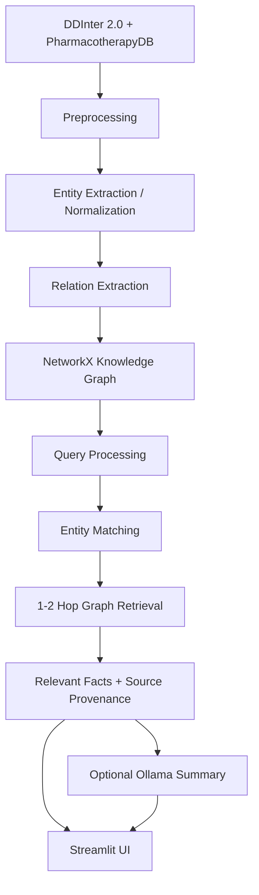

# 🧬 Medical Knowledge Graph-Based Information Retrieval System

MedGraphIR models drug-drug interactions and drug-disease relationships as a graph, then answers
natural-language queries by matching an entity and retrieving its 1-2 hop neighborhood — not by 
asking a language model to recall facts from memory.

Retrieval happens over a real knowledge graph built from **DDInter 2.0**
(~222k drug-drug interactions) and **PharmacotherapyDB** (physician-curated
drug-disease indications), compared against a traditional TF-IDF baseline
and a hybrid method, with results measured on a 30-query evaluation set —
not assumed.

> **This is not a diagnosis tool.** It retrieves and summarizes existing,
> sourced relationships. See [Medical Safety](#medical-safety) below.

## Architecture



The knowledge graph is built **offline** by a standalone script; the
Streamlit app only ever loads and queries the saved graph, never rebuilds
it per request.

## Features

- **Graph-based retrieval** — tiered entity matching (exact / substring /
  partial / fuzzy) with auto-adaptive 1-2 hop traversal
- **BM25 lexical baseline** for comparison
- **Measured evaluation**, not assumed — graph-derived neighbor metrics plus
  a workflow for independent human relevance judgments
- **Optional local LLM summary** (Ollama) grounded only in retrieved facts
  — never invents medical information
- **Streamlit UI** with Search, Evaluation, and About pages

## Quick Start

```bash
pip install -r requirements.txt

python build_graph.py        # build the knowledge graph once (~25s)
streamlit run app.py         # launch the UI
```

Try a query: *"What drugs interact with Warfarin?"*

To reproduce the evaluation numbers:

```bash
python evaluation/evaluate.py
```

This graph-derived benchmark compares returned entities with direct neighbors
from the same graph. It is useful for checking retrieval behavior, but it is
not independent relevance ground truth. To evaluate whether retrieved records
are relevant to a query, build a pooled candidate set, manually judge every
candidate, and then score those judgments:

```bash
python evaluation/build_judgment_pool.py
python evaluation/draft_judgments.py
python evaluation/evaluate_judgments.py
```

The pool uses 30 varied queries from `evaluation/judgment_queries.csv` and
collects the top results from graph and BM25 retrieval.
Candidate order is deterministically shuffled per query and method/rank
provenance is omitted from the annotation file to reduce assessor bias.
Initial relevance values are conservative automatic suggestions based on
whether a candidate contains the query's entity and expected relation; they
are not human judgments until reviewed. The evaluator refuses to run until
every row has a relevance grade. The judged evaluation reports
P@5/10/20, pooled Recall@20, MAP@20, and graded NDCG@5/10. Recall is relative
to relevant records found in this top-20-per-method pool, not exhaustive
relevance over the full corpus.
Rebuilding the pool preserves existing grades for matching query/record pairs;
new or changed candidates must also be judged before evaluation.

Both methods search the same processed relation records, but their query
capabilities differ: graph retrieval resolves an entity and can filter
relationship types before traversing neighbors, while BM25 ranks records
lexically without entity resolution. This distinction should be considered
when interpreting comparisons.

## Results

Graph-derived results on 30 test queries (`python evaluation/evaluate.py`):

| Method | Precision | Recall | F1 | Avg. time |
|---|---|---|---|---|
| **Graph retrieval** | 1.000 | 0.699 | 0.717 | 2.0ms |
| BM25 baseline | 0.594 | 0.465 | 0.359 | 2.6ms |

These scores are against graph-derived expected neighbors, not independent
human relevance judgments. Do not interpret them as evidence that graph
retrieval is generally more relevant to users.

Independent human-judgment results on the pooled 30-query set
(`python evaluation/evaluate_judgments.py`) — the more meaningful comparison:

| Method | P@5 | P@20 | Recall@20 | MAP@20 | NDCG@10 |
|---|---|---|---|---|---|
| Graph retrieval | 0.807 | 0.573 | 0.648 | 0.865 | 0.959 |
| BM25 baseline | 0.780 | 0.670 | 0.690 | 0.933 | 0.798 |

Against independent judgments the two methods are close and neither
dominates: BM25 leads on pooled MAP@20 and Recall@20, graph leads on NDCG and
P@5. The graph-derived benchmark above is structurally favorable to graph
retrieval, which is why the human-judgment numbers are the ones to trust.

## Tech Stack

Python, Pandas, NetworkX, scikit-learn, Streamlit, Pydantic, Ollama
(optional).

## Project Structure

```
├── data/               Raw data, processed tables, saved graph
├── src/                Pipeline modules (preprocessing, entity linking,
│                       relation extraction, graph, retrieval, BM25
│                       baseline, Ollama summarization)
├── evaluation/          Graph-derived and human-judgment evaluation scripts
├── build_graph.py       Standalone graph-build script
├── app.py               Streamlit UI
└── DOCUMENTATION.md      Full technical write-up
```

## Data Sources

- **[DDInter 2.0](https://ddinter2.scbdd.com/)** — drug-drug interactions,
  severity-labeled
- **[PharmacotherapyDB 1.0](https://github.com/dhimmel/indications)** —
  physician-curated drug-disease indications

## Medical Safety

This system is an **academic information retrieval prototype**. Retrieved
information should not be used as a substitute for professional medical
advice.
