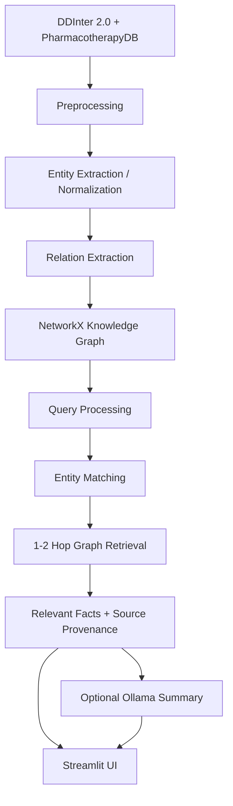

# 🧬 Medical Knowledge Graph-Based Information Retrieval System

An academic **Information Retrieval** project that models drug-drug
interactions and drug-disease relationships as a graph, then answers
natural-language queries by matching an entity and retrieving its 1-2 hop
neighborhood — not by asking a language model to recall facts from memory.

Retrieval happens over a real knowledge graph built from **DDInter 2.0**
(~222k drug-drug interactions) and **PharmacotherapyDB** (physician-curated
drug-disease indications), compared against a traditional TF-IDF baseline
and a hybrid method, with results measured on a 30-query evaluation set —
not assumed.

> **This is not a diagnosis tool.** It retrieves and summarizes existing,
> sourced relationships. See [Medical Safety](#medical-safety) below.

## Architecture



The knowledge graph is built **offline** by a standalone script; the
Streamlit app only ever loads and queries the saved graph, never rebuilds
it per request.

## Features

- **Graph-based retrieval** — tiered entity matching (exact / substring /
  partial / fuzzy) with auto-adaptive 1-2 hop traversal
- **TF-IDF keyword baseline** and a **hybrid (TF-IDF + graph)** method for
  comparison
- **Measured evaluation**, not assumed — Precision/Recall/F1/P@K over a
  30-query, graph-derived ground-truth set
- **Optional local LLM summary** (Ollama) grounded only in retrieved facts
  — never invents medical information
- **Streamlit UI** with Search, Evaluation, and About pages

## Quick Start

```bash
pip install -r requirements.txt

python build_graph.py        # build the knowledge graph once (~25s)
streamlit run app.py         # launch the UI
```

Try a query: *"What drugs interact with Warfarin?"*

To reproduce the evaluation numbers:

```bash
python evaluation/evaluate.py
```

## Results

Measured on the full dataset, 30 test queries:

| Method | Precision | Recall | F1 | Avg. time |
|---|---|---|---|---|
| **Graph retrieval** | 1.000 | 0.699 | 0.717 | 2.1ms |
| Hybrid (TF-IDF + Graph) | 0.696 | 0.598 | 0.438 | 30.4ms |
| TF-IDF baseline | 0.586 | 0.465 | 0.348 | 26.9ms |

Graph retrieval wins on both accuracy and speed. Hybrid never beats pure
graph on this dataset (0/30 query wins) — reported honestly, not assumed
away; see the documentation for why.

## Tech Stack

Python, Pandas, NetworkX, scikit-learn, Streamlit, Pydantic, Ollama
(optional).

## Project Structure

```
├── data/               Raw data, processed tables, saved graph
├── src/                Pipeline modules (preprocessing, entity linking,
│                       relation extraction, graph, retrieval, hybrid,
│                       keyword baseline, Ollama summarization)
├── evaluation/          Test queries, ground truth, evaluation script
├── build_graph.py       Standalone graph-build script
├── app.py               Streamlit UI
└── DOCUMENTATION.md      Full technical write-up
```

## Data Sources

- **[DDInter 2.0](https://ddinter2.scbdd.com/)** — drug-drug interactions,
  severity-labeled
- **[PharmacotherapyDB 1.0](https://github.com/dhimmel/indications)** —
  physician-curated drug-disease indications

## Medical Safety

This system is an **academic information retrieval prototype**. Retrieved
information should not be used as a substitute for professional medical
advice.
