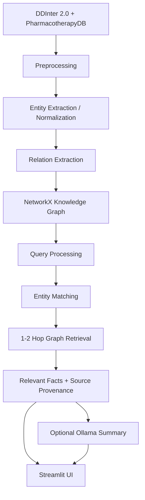

# Medical Knowledge Graph-Based Information Retrieval System

## 1. Problem Statement

Medical facts — which drugs interact with each other, which drugs treat
which diseases — are relational by nature. A plain keyword search over text
cannot easily answer "what interacts with Warfarin?" because the answer is
a *set of connected entities*, not a passage of text.

This project builds an **Information Retrieval (IR) system** that models
drugs and diseases as a knowledge graph and answers relationship queries by
retrieving connected subgraphs — not by asking a language model to recall
facts from memory.

**This is not a diagnosis tool.** It retrieves and summarizes existing,
sourced relationships. See [Medical Safety](#12-medical-safety) below.

## 2. Objectives

- Build a knowledge graph of drugs, diseases, and their relationships from
  real, openly available medical data.
- Support natural-language queries like *"What drugs interact with
  Warfarin?"* by matching the query to a graph entity and retrieving its
  1–2 hop neighborhood.
- Keep the retrieval step (graph traversal) independent of and prior to any
  LLM step — the LLM only summarizes what retrieval already found.
- Evaluate retrieval quality (precision/recall/F1) against a manually
  verified query set, and compare it to a plain keyword baseline.

## 3. Architecture



**The knowledge graph is built offline; query-time retrieval operates
entirely on the pre-built graph.** A standalone script (`build_graph.py`,
Milestone 4) builds it once and saves it to disk. The Streamlit app only
ever *loads and queries* the saved graph — it never rebuilds it per
request.

## 4. Dataset

Two independent, openly downloadable sources are combined. DDInter alone
turned out not to contain any disease data (see Milestone 1 notes below),
so PharmacotherapyDB was added specifically to cover the drug-disease side
of the graph — this was a deliberate scope decision, not an oversight.

### 4.1 DDInter 2.0 — drug-drug interactions (primary source)

Source: <https://ddinter2.scbdd.com/download/>
Downloaded as 8 CSV files, one per top-level ATC drug category
(`ddinter_downloads_code_{A,B,D,H,L,P,R,V}.csv`), ~222k rows total.

| Column | Type | Description |
|---|---|---|
| `DDInterID_A` | string | DDInter's stable ID for drug A, e.g. `DDInter582` |
| `Drug_A` | string | Name of drug A |
| `DDInterID_B` | string | DDInter's stable ID for drug B |
| `Drug_B` | string | Name of drug B |
| `Level` | string | Interaction severity: `Major`, `Moderate`, `Minor`, `Unknown` |

**Note:** the bulk CSV export has *no* free-text mechanism/description
field and *no* disease information — only the 5 columns above. Richer
mechanism text exists on DDInter's individual per-interaction web pages,
but only one pair at a time (222k pages), so it was not scraped for the
MVP. `Level` is the only evidence field available from this source, and is
kept as the `severity` edge attribute.

### 4.2 PharmacotherapyDB 1.0 — drug-disease indications (supplementary source)

Source: <https://github.com/dhimmel/indications> (physician-curated;
601 drugs, 97 diseases, 1,388 rows).

| Column | Type | Description |
|---|---|---|
| `doid_id` | string | Disease Ontology ID, e.g. `DOID:10652` |
| `drugbank_id` | string | DrugBank ID, e.g. `DB00843` |
| `disease` | string | Disease name |
| `drug` | string | Drug name |
| `category` | string | `DM` (disease-modifying), `SYM` (symptomatic), `NOT` (confirmed non-indication) |
| `n_curators` | int | Number of physician curators who confirmed the indication |
| `n_resources` | int | Number of literature resources supporting it |

91% (548/601) of the drugs in this dataset also appear in DDInter, so the
two sources connect into one graph rather than sitting as disconnected
islands (verified during Milestone 1 — e.g. `metformin` appears in both;
`warfarin` only appears in DDInter, which is expected and fine).

### 4.3 Processed schema (output of `src/preprocessing.py`)

Both sources are normalized to the same flat shape before entity
extraction:

| Column | Meaning |
|---|---|
| `record_id` | Unique ID for provenance, e.g. `ddinter_DDInter582_DDInter725` or `pharmdb_DB00843_DOID:10652` |
| `source_entity` / `target_entity` | Raw entity names (not yet canonicalized) |
| `relationship` | One of the controlled relation types (see below) |
| *(source-specific evidence columns)* | `severity`/`atc_code` for interactions; `indication_category`/`n_curators`/`n_resources` for indications |

Row-level cleaning decisions (see docstring in `src/preprocessing.py` for
full rationale):
- Duplicate `(DDInterID_A, DDInterID_B)` pairs across ATC files (~28% of
  raw rows) are dropped, keeping first occurrence.
- PharmacotherapyDB rows with `category == "NOT"` are dropped — these are
  physician-confirmed *negative* indications, so keeping them would assert
  the opposite of the source.

### 4.4 Controlled relationship vocabulary

| Relationship | Used for |
|---|---|
| `INTERACTS_WITH` | DDInter drug-drug interactions |
| `TREATS` | PharmacotherapyDB drug-disease indications (DM or SYM) |
| `CONTRAINDICATED_IN` | reserved for future structured data |
| `CAUTION_IN` | reserved for future structured data |
| `ASSOCIATED_WITH` | reserved for future/LLM-inferred relations |

No relation label outside this fixed set is ever written to the graph.

## 5. Technology Stack

Python 3.x, Pandas, NetworkX, Scikit-learn, Streamlit, Ollama (optional),
Pydantic, Pyvis (graph visualization in the UI). No Neo4j, vector
databases, LangChain, or agent frameworks — kept intentionally lightweight.

## 6. Project Structure

```
medical-graph-ir/
├── data/
│   ├── raw/            DDInter CSVs + PharmacotherapyDB TSV (downloaded, gitignored)
│   ├── processed/       Cleaned record-level tables (src/preprocessing.py output)
│   └── graph/            Saved NetworkX graph (build_graph.py output)
├── src/
│   ├── config.py         All paths & tunable constants
│   ├── data_loader.py     Loads raw CSV/TSV files
│   ├── preprocessing.py   Row-level cleaning -> processed tables
│   ├── entity_extraction.py   Structured mention extraction (drug/disease)
│   ├── entity_linking.py      Normalization -> canonical entity table + IDs
│   ├── relation_extraction.py Structured (+ optional LLM) -> validated Relation triples
│   ├── graph_builder.py       Builds/saves/loads the NetworkX graph
│   ├── retrieval.py           Query matching + 1-2 hop ranked retrieval (the core IR engine)
│   ├── keyword_baseline.py    TF-IDF traditional IR baseline (for comparison, Milestone 7)
│   ├── hybrid_retrieval.py    Fuses TF-IDF + graph scores (extension, section 8.6)
│   └── answer_generator.py    Optional Ollama summary layer over retrieved facts
├── evaluation/
│   ├── build_test_queries.py  Derives test_queries.csv ground truth from the real graph
│   ├── test_queries.csv       30 manually-curated queries with graph-derived expected answers
│   ├── evaluate.py            Runs both methods, computes P/R/F1/P@K/timing
│   ├── results_detailed.csv   Per-query results (generated)
│   └── results_summary.csv    Aggregate comparison table (generated)
├── build_graph.py         Standalone script: runs the full pipeline, saves the graph
├── app.py                 Streamlit UI (search, graph viz, evidence table, optional AI summary)
├── requirements.txt
└── README.md
```

## 7. Installation

```bash
pip install -r requirements.txt
```

Raw data is already downloaded into `data/raw/`. To re-download it from
scratch:

```bash
# DDInter 2.0 (8 files)
for code in A B D H L P R V; do
  curl -o data/raw/ddinter_downloads_code_${code}.csv \
    https://ddinter2.scbdd.com/static/media/download/ddinter_downloads_code_${code}.csv
done

# PharmacotherapyDB
curl -o data/raw/pharmacotherapydb_indications.tsv \
  https://raw.githubusercontent.com/dhimmel/indications/gh-pages/catalog/indications.tsv
```

## 8. Running the pipeline so far

The individual modules can still be run one at a time for debugging
(each uses the dev-scale `MAX_ROWS_PER_FILE` sample from `config.py`):

```bash
python -m src.data_loader          # sanity-check raw loading + logging
python -m src.preprocessing        # produces data/processed/{interactions,indications}_clean.csv
python -m src.entity_linking       # produces data/processed/entities.csv
python -m src.relation_extraction  # produces data/processed/relations.csv
python -m src.graph_builder        # produces data/graph/medical_kg.pkl
python -m src.retrieval            # demo queries against the graph retrieval engine
python -m src.keyword_baseline     # demo queries against the TF-IDF baseline
```

But the real build (used by the rest of the project from here on) is the
standalone end-to-end script, run once on the **full** dataset:

```bash
python build_graph.py                # full ~222k-row dataset (~25s)
python build_graph.py --max-rows 2000 # quick full-pipeline dry run
```

`MAX_ROWS_PER_FILE` in `src/config.py` controls how many rows are read per
DDInter file during development (default `2000`). Set it to `None` for the
full ~222k-row dataset before the final build.

### 8.1 Entity table (output of `src/entity_linking.py`)

| Column | Meaning |
|---|---|
| `entity_id` | Stable graph node key, e.g. `drug::metformin`, `disease::alzheimer_s_disease` |
| `canonical_name` | Most frequently seen raw casing/variant, used for display |
| `entity_type` | `DRUG` or `DISEASE` |
| `normalized_name` | Lowercased, whitespace-collapsed join key (punctuation preserved - see module docstring for why) |
| `aliases` | All distinct raw name variants seen, pipe-separated |
| `mention_count` | How many records reference this entity (a simple support/frequency signal used later in ranking) |

Normalization is deliberately minimal: lowercase + whitespace collapse
only. Punctuation is kept because it can be semantically load-bearing in
this data — e.g. `Amphotericin B (liposomal)` and `Amphotericin B
(cholesteryl sulfate)` are different formulations with different
interaction profiles, not casing noise, so a naive "strip all punctuation"
normalizer would have silently merged them into one incorrect node.

This step is also what merges the two data sources into one graph: e.g.
`metformin` from DDInter and `metformin` from PharmacotherapyDB resolve to
the same `drug::metformin` node, so both its interactions and its
indications are reachable from a single entity.

### 8.2 Relation extraction (output of `src/relation_extraction.py`)

Every interaction/indication row already carries an explicit, reliable
relationship (assigned in `preprocessing.py`), so the primary extraction
path is structured: each row is packaged into a Pydantic `Relation` object
(`source_entity_id, relationship, target_entity_id, record_id, evidence,
attributes`) and validated against the controlled vocabulary in
`config.VALID_RELATIONS`. No LLM is involved in this path, per the brief's
rule that dataset-provided relationships take priority over LLM inference.

An optional `extract_relation_with_llm()` path also exists, for the case
where a relationship must be inferred from free text using a local Ollama
model, constrained to the same controlled vocabulary and validated the
same way — an LLM can never inject an arbitrary relationship label. It is
**not invoked by the current pipeline**, because neither data source has a
free-text field to run it on (see Limitations), not because of any Ollama
setup issue — the path is implemented and ready for the moment a
free-text source is added. This is a different Ollama use case from the
answer-generation stage: that one *is* exercised end-to-end with a real
running model, see section 9.2.

```bash
python -m src.relation_extraction
```
Result on the dev sample: 14,046 validated relations (12,901
`INTERACTS_WITH`, 1,145 `TREATS`), 0 rejected. The `__main__` block also
deliberately constructs a `Relation` with an invalid label (`CURES`) to
prove the Pydantic validator actually rejects it rather than silently
allowing arbitrary labels through.

### 8.3 Knowledge graph (output of `src/graph_builder.py` / `build_graph.py`)

A single `networkx.DiGraph`, saved with plain Python `pickle` (NetworkX
3.x dropped its own `write_gpickle`/`read_gpickle` helpers) to
`data/graph/medical_kg.pkl`. Built once by `build_graph.py`; the
Streamlit app (Milestone 9) will only ever load this file, never rebuild
it per request.

**On the full dataset:** 2,075 nodes (1,984 drugs, 91 diseases), 161,380
edges, 0 isolated nodes, built in ~25s.

**Node attributes:** `entity_id`, `canonical_name`, `entity_type`,
`aliases` (list), `mention_count`.

**Edge attributes:** `relationship`, `record_id` (source row, for
provenance), `evidence` (human-readable source text), plus flattened
source-specific fields (`severity`/`atc_code` for `INTERACTS_WITH`;
`indication_category`/`n_curators`/`n_resources` for `TREATS`).

**Design decision — edge direction for `INTERACTS_WITH`:** drug-drug
interactions are conceptually symmetric, but DDInter records each one as
exactly one row in one direction only (verified in Milestone 1: no pair
ever appears in both directions). Rather than inserting a fabricated
reverse edge with a made-up record ID, the graph stores exactly one edge
per source row — a direct 1:1 mapping to provenance. This means
**retrieval must check both outgoing and incoming edges** when expanding
an `INTERACTS_WITH` node; `TREATS` stays purely directional
(drug → disease) since that relationship isn't symmetric. This is the
first thing Milestone 5 needs to get right.

**Finding worth flagging for Milestone 5 (query matching):** DDInter uses
generic/INN drug names, not brand names — e.g. `Aspirin` isn't a node,
`Acetylsalicylic acid` is. Exact-string query matching alone will miss
common brand-name queries, which is part of why the brief asks for
fuzzy/partial matching, not just exact matching.

### 8.4 Retrieval engine (`src/retrieval.py`)

The core IR component. `retrieve_relationships(query, G, index)` runs the
full pipeline: normalize -> match query to an entity (4 transparent
tiers: EXACT -> SUBSTRING -> PARTIAL -> FUZZY, see module docstring) ->
1-hop retrieval -> optional 2-hop retrieval (seeded from only the top
`TWO_HOP_MAX_SEED_NODES` 1-hop neighbors, to stop a high-degree node like
Warfarin from exploding the subgraph) -> consolidate duplicate facts ->
rank (hop distance first, then severity/curator-support as a tiebreaker -
no PageRank, no learned model) -> top-K.

`build_entity_index()` / `load_retrieval_engine()` build the alias lookup
and load the graph **once**; `retrieve_relationships()` itself does no
disk I/O, so repeated queries stay fast (see measured timings below).

```bash
python -m src.retrieval
```

Real results from the full graph (not simulated):

| Query | Matched entity | Result |
|---|---|---|
| "What drugs interact with Warfarin?" | Warfarin (SUBSTRING) | 20 top-ranked `INTERACTS_WITH` facts, ranked by severity, in ~60ms |
| "What diseases are associated with Metformin?" | Metformin (SUBSTRING) | 3 direct `TREATS` facts + 2-hop drugs sharing the same disease, in <1ms |
| "What drugs are related to Diabetes?" | *ambiguous* | Best guess: gestational diabetes; candidates also surface type 1 and type 2 diabetes mellitus - see below |
| "Worfarin" (typo) | Warfarin (FUZZY, 0.875) | correctly recovers from the typo |
| "xyzabc123" | none | empty result, no crash |

**Bug found and fixed while testing against the brief's own example
queries:** "What drugs are related to Diabetes?" initially returned no
match. The data models diabetes as three separate entities (`gestational
diabetes`, `type 1 diabetes mellitus`, `type 2 diabetes mellitus`) and the
matcher only checked whether the query *contained* a full known name, not
the reverse (a short query word being contained *inside* a longer name).
Added a PARTIAL tier for this, then found a second issue: the first
version silently picked the shortest containing name and hid the other
two. Since all three are real, distinct entities, that's a genuine
ambiguous-match case (see README Milestone 10), not a bug to paper over -
fixed by having PARTIAL/FUZZY matches surface every alternative as a
`candidate_match` rather than silently guessing one.

**Known scope limitation:** matching finds the single best entity
mentioned in the query. A two-entity query like "Show the connections
between Metformin and kidney disease" resolves to Metformin's own 1-2 hop
neighborhood, not a path search between two named entities - there is no
`disease::kidney_disease` node anyway (the data has `chronic kidney
failure` and `kidney cancer` as separate, more specific entities). Path-
finding between two named entities (e.g. via `networkx.shortest_path`)
would be a reasonable, scoped future extension, not implemented now since
it isn't part of the Milestone 5 API the brief specifies.

### 8.5 Keyword baseline (`src/keyword_baseline.py`)

A traditional, non-graph IR baseline to compare graph retrieval against -
this comparison is the whole reason this is an IR project rather than
just "a graph with a search box" (brief, Milestone 6). Each relation
record (one interaction or indication row) is flattened into a bag-of-
words document (`source_entity + relationship + target_entity +
evidence`) and indexed with scikit-learn's `TfidfVectorizer`; a query is
ranked against every document by cosine similarity. It has **no concept
of connected entities or relationship type** - purely term overlap.

```bash
python -m src.keyword_baseline
```

Index build (TF-IDF fit over all 161,380 records): ~11.4s, one-time.
Per-query search after that: ~33ms.

**The comparison already shows exactly what it's supposed to.** For
`"What diseases are associated with Metformin?"`, the keyword baseline's
top 8 results are **all `INTERACTS_WITH` records, zero `TREATS` records**
— "metformin" is a high-IDF term that co-occurs with hundreds of
interaction rows, which drown out the 3 real disease-treatment facts
entirely. The graph retriever gets this right (Milestone 5) because it
can filter by relationship type and traverse the graph structurally,
not just match vocabulary. For a query like `"What drugs interact with
Warfarin?"`, where the dominant term ("warfarin") happens to be rare and
distinctive enough to correlate with relevance anyway, the keyword
baseline does reasonably - the gap is specific to queries where the
*relationship type*, not just the entity name, determines relevance.
Milestone 7 turns this into a measured Precision/Recall/F1 comparison
rather than eyeballed examples.

### 8.6 Hybrid retrieval (`src/hybrid_retrieval.py`)

A third method added after the first two were already working and
evaluated: `retrieve_hybrid(query, G, index, keyword_retriever, alpha,
beta)` combines TF-IDF lexical relevance with graph structural relevance
into one ranked result, using

```
HybridScore = alpha x normalized_TFIDF_score + beta x normalized_Graph_score
```

with `alpha=beta=0.5` by default (both configurable in `config.py` as
`HYBRID_ALPHA_DEFAULT`/`HYBRID_BETA_DEFAULT`, or per-call). It does not
reimplement either method - it calls `retrieve_relationships()` and
`KeywordRetriever.search()` exactly as they already exist (each queried
for a wider `HYBRID_CANDIDATE_POOL_K=50` candidate pool, not just
`TOP_K_RESULTS`, so a candidate ranked modestly by one method still has a
chance to surface after the scores are combined), then merges the two
result sets by `record_id` - the one identifier both methods share, since
graph edges and keyword documents are both built from the same relation
rows. Each method's own scores are min-max normalized to `[0,1]`
independently before combining, since TF-IDF cosine similarity is
naturally bounded but the graph's `rank_score` is an unbounded additive
score (roughly 0-15) that would otherwise dominate arbitrarily.

**`KeywordResult` gained three fields** (`source_entity_id`,
`target_entity_id`, `attributes`) so hybrid can build a full
`RetrievedFact` for TF-IDF-only candidates - purely additive, nothing
existing was removed, and the pre-existing keyword-baseline evaluation
code (which only reads the original fields) is unaffected.

**Two real bugs were caught and fixed while testing the required
`alpha=1,beta=0 == pure TF-IDF` / `alpha=0,beta=1 == pure Graph`
equivalence properties** - these weren't rubber-stamped, they initially
failed:

1. Min-max normalization maps the *worst*-scoring candidate in a pool to
   exactly `0.0`. A naive "drop anything with `hybrid_score <= 0`" filter
   then wrongly excluded legitimately-retrieved candidates that happened
   to tie at their method's minimum score (common - many `TREATS` facts
   share the same capped support bonus). Fixed by tracking *membership*
   (was this candidate found by a positively-weighted method at all?)
   separately from its normalized score value.
2. Ties in the combined score (also common) were being broken by
   whichever method's result list got iterated first when building the
   candidate set - which matched one degenerate case but silently broke
   the other. Fixed with a tiebreaker that blends each candidate's own
   rank *position* in its source method's list, weighted by the same
   alpha/beta - so the tiebreak itself collapses to pure graph's tie order
   when alpha=0, and pure keyword's when beta=0.

After both fixes, verified directly (not assumed) across 5 real queries
spanning high/low-degree drugs and both relationship types: `alpha=1,
beta=0` reproduces pure TF-IDF's result set **and order** exactly;
`alpha=0, beta=1` reproduces pure graph's exactly. Also verified: facts
found by both methods merge into one deduplicated entry (no double-count
in the output); a mixed query genuinely returns both graph-sourced (hop
1/2) and TF-IDF-only (hop `0`, a sentinel meaning "not from graph
traversal") facts together; unknown/empty queries return zero facts with
no crash.

```bash
python -m src.hybrid_retrieval
```

## 9. Evaluation Methodology

`evaluation/test_queries.csv` has 30 manually-curated natural-language
queries. The list of *which* real entities to ask about was chosen by
hand (a deliberate mix: high/low-degree drugs, drug→disease and
disease→drug directions, unfiltered "tell me about X" queries, 2 typo-
recovery cases, 2 negative/unknown-entity cases) but the *expected
answers* were computed directly from the saved graph by
`evaluation/build_test_queries.py`, not hand-typed - so ground truth can't
drift from what the graph actually contains.

`evaluation/evaluate.py` runs both the graph retriever (`max_hops=1`, to
match how ground truth is defined - direct neighbors) and the keyword
baseline against every query, extracts "the other entity" in each
returned fact/record, and computes Precision / Recall / F1 / Precision@5 /
Precision@10 / retrieval time per query, then macro-averages.

**Actual measured results** (from `evaluation/results_summary.csv`,
30 queries, full ~222k-row dataset):

| Method | Precision | Recall | F1 | Precision@5 | Precision@10 | Avg. retrieval time |
|---|---|---|---|---|---|---|
| Graph retrieval | 1.000 | 0.699 | 0.717 | 1.000 | 1.000 | 4.7ms |
| Keyword (TF-IDF) baseline | 0.586 | 0.465 | 0.348 | 0.647 | 0.607 | 32.0ms |

Graph retrieval wins on F1 for 13/30 queries and ties on 17/30 (mostly the
2 negative-entity cases, plus queries where the entity name is rare/
distinctive enough that keyword search happens to work just as well, e.g.
"Doripenem"); **keyword search never wins outright on any query.**
Reported this way deliberately, instead of "graph wins every time" -
because it's the true result and it's more useful: it shows precisely
*when* the graph's structural filtering matters (queries with real
relationship-type ambiguity) versus when it doesn't (queries where the
query term alone is already unambiguous).

Two illustrative real per-query results:
- `"What diseases does Metformin treat?"` — graph: 1.0 / 1.0 / 1.0.
  Keyword: **0.0 / 0.0 / 0.0** - none of its top-20 results were among the
  3 correct diseases; term overlap on "metformin" surfaced only
  `INTERACTS_WITH` records (see Milestone 6 finding).
- `"What drugs treat Kawasaki disease?"` — graph: 1.0 / 1.0 / 1.0 (1
  correct answer, cleanly retrieved). Keyword: precision 0.042 - it does
  find the 1 correct drug (recall 1.0), but buries it among 23 other
  loosely term-matched records.

Graph retrieval's precision is exactly 1.0 by construction for a 1-hop
query - every fact it returns came from literally traversing a real edge,
so it cannot return an entity that isn't actually connected. Recall
0.699 (not 1.0) reflects `TOP_K_RESULTS=20` truncating high-degree nodes
like Warfarin (864 real interactions) - a real, expected precision/recall
trade-off from ranking and cutting off results, not an error.

**A real bug was caught by this evaluation, not by casual testing:**
running the typo query `"What drugs interact with Worfarin?"` end-to-end
matched **"Polyethylene glycol (3350 with electrolytes)"** instead of
Warfarin - and the negative test `"...Zzznonexistentdrug?"` matched the
same wrong entity instead of correctly finding nothing. Root cause: the
filler word "with" in the query happened to literally appear inside that
drug's parenthetical qualifier, and the PARTIAL-match tier tried it before
ever reaching "Worfarin". Fixed in `src/retrieval.py` by stripping a small
query-stopword list before generating match candidates for the
PARTIAL/FUZZY tiers (documented in `_QUERY_STOPWORDS`); the numbers above
are from the corrected code, re-run after the fix, not the buggy first
pass.

```bash
python evaluation/build_test_queries.py   # regenerate ground truth from the current graph
python evaluation/evaluate.py             # run the comparison, print + save results
```

### 9.1 Hybrid retrieval evaluation - does it actually help?

The brief was explicit: don't assume hybrid wins, report the real number.
Added as a third method to the same 30-query evaluation, `evaluate.py`
now measures graph, keyword, and hybrid (default `alpha=beta=0.5`,
`max_hops=1` for the same apples-to-apples reason as graph) together,
saved to the same `results_summary.csv` (graph/keyword rows verified
numerically identical to the pre-hybrid baseline - see Limitations note
below).

| Method | Precision | Recall | F1 | P@5 | P@10 | Avg. time |
|---|---|---|---|---|---|---|
| Graph retrieval | 1.000 | 0.699 | 0.717 | 1.000 | 1.000 | 2.1ms |
| Hybrid (0.5/0.5) | 0.696 | 0.598 | 0.438 | 0.813 | 0.737 | 30.4ms |
| Keyword (TF-IDF) | 0.586 | 0.465 | 0.348 | 0.647 | 0.607 | 26.9ms |

**Weight sweep** (`evaluation/results_weight_sweep.csv`), hybrid alone at
three alpha(TF-IDF)/beta(Graph) splits:

| Weights | Precision | Recall | F1 | P@5 | P@10 |
|---|---|---|---|---|---|
| alpha=0.7, beta=0.3 | 0.669 | 0.562 | 0.408 | 0.713 | 0.673 |
| alpha=0.5, beta=0.5 | 0.696 | 0.598 | 0.438 | 0.813 | 0.737 |
| alpha=0.3, beta=0.7 | 0.719 | 0.623 | 0.462 | 0.847 | 0.773 |

**Honest answer: no, hybrid does not improve over pure graph retrieval on
this evaluation set.** Every metric moves monotonically toward graph's
numbers as beta increases, which is itself informative - it says the
graph's structural signal is simply more reliable than TF-IDF's lexical
signal for this task, so blending in any lexical weight can only dilute
quality relative to pure graph, never improve it. Per-query: **graph beats
hybrid on F1 for 11/30 queries, hybrid beats graph on 0/30, and they tie
on 19/30** (mostly the negative-entity cases and queries where TF-IDF
found nothing to blend in). Hybrid does consistently beat pure keyword
(8/30 F1 wins for keyword-only vs. more for hybrid, never worse) - so it
inherits graph's benefit over keyword, it just can't exceed graph itself.

The concrete failure mode, same query used throughout this README:
`"What diseases does Metformin treat?"` - graph: 1.0/1.0/1.0 (finds
exactly the 3 correct diseases). Hybrid: 0.05/0.33/0.087 - it does recover
some signal from graph (1 of 3 diseases now found, vs. 0 for pure
keyword), but precision collapses because keyword's `INTERACTS_WITH`
noise (established in section 8.5) still floods most of the merged top-20
once alpha>0 gives it any weight at all. This is exactly the mechanism
the brief asked to test for, not assume away.

**Why this result is trustworthy, not just convenient:** it's not "hybrid
is broken" - `alpha=1,beta=0`/`alpha=0,beta=1` were verified to exactly
reproduce pure TF-IDF/pure graph respectively (section 8.6), so the
fusion math is correct. It's that on *this* dataset, graph's relationship-
type filtering is already close to ideal for these queries (precision
1.0, recall bounded only by top-K truncation), leaving lexical scoring
nothing to usefully contribute and every opportunity to introduce noise.
A dataset with noisier/incomplete graph edges (where TF-IDF could recover
facts the graph misses) might show a different result - worth flagging as
a natural follow-up, not evidence the current measurement is wrong.

```bash
python evaluation/evaluate.py   # now also runs hybrid + the weight sweep
```

### 9.2 Optional Ollama summary (`src/answer_generator.py`)

The last, strictly optional pipeline stage: `generate_answer(query, result)`
takes an already-computed `RetrievalResult` and asks a local Ollama model
to summarize it - retrieval and ranking are fully done before Ollama is
ever involved, so a bad or missing LLM can't change what facts were found,
only how they're phrased.

The prompt (`build_prompt`) gives the model the retrieved facts as
numbered context, each labeled `[direct]` (1-hop, directly connected to
the matched entity) or `[2-hop]` (reached through an intermediate entity,
extra context only) - this was added after noticing the first version of
the prompt mixed all hops together with no signal about which facts
directly answer the question versus which are supplementary, which risked
the model over-weighting tangential 2-hop facts. Rules embedded in the
prompt: use only the listed facts, say so explicitly when they don't fully
answer the question, avoid diagnostic/prescriptive language, stay
concise. A lightweight keyword scan (`_contains_prescriptive_language`)
logs a warning if the output looks prescriptive anyway - best-effort
defensive logging, not a hard guarantee.

`generate_answer()` never raises. It returns an `AnswerResult` with
`ollama_available=False` and an explanatory `note` for every failure mode:
no facts to summarize (skips the LLM call entirely), the `ollama` package
not installed, the Ollama service unreachable, the model not pulled, or
an empty response. The caller (the Streamlit app, Milestone 9) always has
`result.facts` available regardless of whether generation succeeded, so
the app works with or without Ollama - per the brief's requirement.

```bash
python -m src.answer_generator
```

**Update:** Ollama was initially not installed in the dev environment, so
the graceful "package not installed" fallback was verified first:
```json
{"summary": null, "facts_used": 20, "ollama_available": false,
 "note": "Ollama is not installed; showing retrieved facts only."}
```
This surfaced a real gotcha worth noting: having the **Ollama application/
service running** (`localhost:11434` reachable, model pulled) is not the
same as the **`ollama` Python package** being installed in the
environment running the app - `pip install -r requirements.txt` covers
it, but if that env was set up before `ollama` was added to
`requirements.txt`, or a different Python interpreter is used, the
package can be missing even with the service fully working. That's
exactly what happened here: the service and `llama3.2` model were
confirmed live and working (`curl localhost:11434/api/tags` returned the
model), but `generate_answer()` still reported "not installed" until
`ollama` was pip-installed into the same interpreter running Streamlit.

After fixing that, live generation was verified end-to-end for real, not
simulated:
```
python -m src.answer_generator
```
Real output for "What diseases does Metformin treat?" (20 retrieved
facts, 3 direct + 17 2-hop):
> "The retrieved records indicate that Metformin treats type 2 diabetes
> mellitus, metabolic syndrome X, and polycystic ovary syndrome."

Note it correctly used only the 3 `[direct]` facts and ignored the 17
`[2-hop]` facts about other drugs treating the same disease - exactly
what the hop-labeling in the prompt (above) was designed to achieve. Also
verified through the actual Streamlit app (via `AppTest`) that the AI
Summary section now shows a real `st.success` box with generated text
instead of the fallback caption.

### 9.3 Streamlit app (`app.py`)

```bash
streamlit run app.py
```

The graph is loaded once via `st.cache_resource` (not rebuilt or reloaded
per query - see section 13, Performance). A top-of-sidebar nav radio
(`🔎 Search / 📊 Evaluation / ℹ️ About`) switches between three views, all
in `app.py` - no `pages/` directory, kept as one file for a project this
size.

**🔎 Search**: disclaimer banner, a sidebar with live graph stats, an
auto-adaptive hops toggle (see below), a `Retrieval Method: Graph /
TF-IDF` selector, and an "enable AI summary" checkbox, then a search form,
then (once you search) Matched Entity → Retrieved Relationships (quick
text view) → Knowledge Graph (interactive pyvis visualization) →
Retrieved Evidence (full sortable table with severity/indication/record
ID/score) → optional AI Summary.

**📊 Evaluation**: reads the CSVs `evaluation/evaluate.py` already saved
(does not re-run the ~30s evaluation on every page view - same "build
once, load fast" pattern as the graph itself), laid out in three numbered
sections: (1) per-method metric cards (Precision/Recall/F1/Avg. time),
(2) a bar chart grouped **by method** with Precision/Recall/F1 as the
three bars per group - deliberately this orientation, not metric-grouped,
because "which method wins" reads faster than "which metric is highest",
(3) a separate retrieval-speed chart, with the honest observation that
graph is both the most precise *and* the fastest per query. Below that,
the same "hybrid doesn't beat graph" finding from section 9.1 written out
on the page itself, then the weight-sweep chart and the full 30×3
per-query table tucked into expanders so they don't clutter the primary
view. Degrades gracefully with a clear message if `evaluate.py` hasn't
been run yet.

**ℹ️ About**: a short, static project summary (what it is, data sources,
pipeline, tech stack, the medical disclaimer again) for anyone who lands
on the app without having read the README first.

Known, accepted UX trade-off: navigating away from Search and back clears
the typed query and any shown results - Streamlit only persists a
widget's state while it keeps being rendered every run, and the search
form isn't rendered while another page is showing. Deliberately left
as-is (asked, and the answer was to keep it simple) rather than adding
`st.session_state` bookkeeping for a convenience-only fix.

**Auto-adaptive hops (default on).** Rather than a fixed manual `max_hops`
toggle, `retrieve_relationships(..., adaptive_hops=True)` decides the hop
depth per query from the matched entity's own 1-hop connection count: if
it already has `top_k` or more direct connections, 2-hop expansion is
skipped (hop=1 facts always outrank hop=2 in the existing ranking, so with
this many direct facts 2-hop results would rarely surface anyway, and
skipping the traversal saves time); below that threshold, 2-hop expansion
runs as usual to add context for an otherwise sparse entity. Verified
directly: `"What drugs interact with Warfarin?"` (864 connections) →
auto-picks 1 hop; `"What drugs interact with Doripenem?"` (4 connections)
→ auto-picks 2 hops - shown to the user via a caption explaining which was
chosen and why, not a silent decision. A manual override (`Max hops`
radio, 1/2) is still available by unchecking the auto-adaptive box; the
underlying parameter is fully backward compatible - it defaults to off,
so `evaluate.py` and any other existing caller are unaffected.

**Hybrid retrieval was tried in the UI and removed.** A `Graph / TF-IDF /
Hybrid` selector with alpha/beta sliders was built and tested working, but
removed as unnecessary UI complexity once section 9.1's evaluation showed
hybrid never beats pure graph on this dataset (0/30 query wins) - a
control that only ever makes results worse or identical isn't worth the
extra sidebar surface. The module (`src/hybrid_retrieval.py`) and its
evaluation comparison are kept, since the *finding* (hybrid doesn't help
here, and why) is the valuable part, not the UI control itself.

The graph visualization is built directly from `result.facts`, not a full
`networkx` induced subgraph - an induced subgraph would also draw any
incidental edges between two retrieved nodes that happen to connect to
each other but weren't actually part of what was retrieved, which would
make the picture inconsistent with the evidence table sitting right next
to it. Every edge drawn matches a row in that table, nothing extra.

**Tested without a browser tool available this session** (declined during
setup) using Streamlit's official `AppTest` API, which runs the real app
script and simulates real widget interactions (typing into the search
box, clicking Search, changing the sidebar radio) headlessly - a
genuinely stronger check than eyeballing a screenshot, since it inspects
the actual rendered element tree and catches exceptions directly:

- Warfarin query: 0 exceptions, all 5 expected subheaders rendered, matched
  entity + severities correct, evidence dataframe present, AI Summary
  section correctly showed the graceful "Ollama is not installed" caption
  at the time (not a false success) - and after Ollama was set up (see
  section 9.2), re-running the same test showed a real `st.success` box
  with generated text instead.
- No-match query (`xyzabc123`): 0 exceptions, exact warning text from the
  brief ("No matching medical entity was found...").
- Empty query: 0 exceptions, "Please enter a query." warning.
- Ambiguous query ("Diabetes"): 0 exceptions, correctly shows "also
  matched: type 2 diabetes mellitus, type 1 diabetes mellitus" while still
  rendering full results for the best guess.
- Sidebar `max_hops=1` (manual override, auto-adaptive unchecked):
  confirmed the results table's `Hop` column actually capped at 1, not
  just that the widget existed.
- Auto-adaptive hops: confirmed Warfarin's results table only contains
  `Hop=1` rows and Doripenem's contains both `Hop=1` and `Hop=2` - the
  decision is real, not just a caption claiming it.
- Also fixed a real (if minor) issue found this way: `st.dataframe(...,
  use_container_width=True)` triggered a deprecation warning whose stated
  removal date had already passed relative to today - switched to
  `width="stretch"`, then re-ran the same test to confirm the warning was
  gone.

The server was also started for real (`streamlit run app.py
--server.headless true`) and confirmed serving on `localhost:8501`
(HTTP 200) - if you have a browser available, that's the URL to open;
`AppTest` covers correctness, but only a real browser shows you the
rendered pyvis graph.

### 9.4 Error handling pass (Milestone 10)

A dedicated pass through every scenario the brief requires, tested with
`AppTest` (not assumed from earlier incidental testing) and, where
relevant, against the real saved graph file - not mocks:

| Scenario | Behavior | Verified how |
|---|---|---|
| Unknown medical term | "No matching medical entity was found in the current knowledge graph." | `AppTest`, query `xyzabc123` |
| Empty query | "Please enter a query." | `AppTest`, empty string |
| Whitespace-only query | Same as empty (caught by `.strip()`) | `AppTest`, query `"   "` |
| Ollama not running | App still works; facts shown; AI Summary section shows a plain caption instead of a false success | Real - `ollama` package genuinely isn't installed here, not mocked |
| Missing dataset | Clean `st.error` pointing at `python build_graph.py`, no traceback | Real - graph file renamed away, tested, restored |
| Invalid graph | Clean `st.error` with the exception type/message, points at rebuilding | Real - graph file replaced with garbage bytes, tested, restored, then **checksummed against a backup** to confirm restoration was exact |
| No relationships found | See below - this one uncovered a real design gap | `AppTest`, query "What diseases does Doripenem treat?" |
| Multiple possible entity matches | `st.info` lists alternatives, full results still shown for the best guess | `AppTest`, "Diabetes" query |

**Two real fixes came out of this pass, not just confirmations:**

1. **Filter-relaxation fallback (`src/retrieval.py`).** Doripenem has real
   graph data (4 interactions) but zero `TREATS` edges. Before this pass,
   asking "What diseases does Doripenem treat?" inferred a `TREATS`
   filter, found nothing, and dead-ended with a bare "no results"
   warning — technically correct, but a worse experience than it needed
   to be, since the entity genuinely has other real, useful data. Fixed
   by relaxing the filter and showing all relationship types when the
   inferred filter finds nothing, with `RetrievalResult.
   relationship_filter_relaxed` flagging it so the UI can explain what
   happened ("No relationships of the expected type were found... showing
   all relationship types instead") rather than silently switching topics.
   Re-ran the full Milestone 7 evaluation afterward to confirm this
   didn't change any of the 30 curated queries' scores (it doesn't -
   every ground-truth query was deliberately chosen to have real data of
   its expected type, so the fallback never triggers for them).

2. **Corrupted-graph handling (`app.py`).** The original `except
   FileNotFoundError:` only caught a missing file. A corrupted graph file
   raises `pickle.UnpicklingError`, a completely different exception type
   that would have skipped past that `except` clause and shown Streamlit's
   raw traceback screen instead of a clean message. Found by deliberately
   replacing the real graph file with garbage bytes and watching what
   actually happened (it wasn't caught) rather than assuming the existing
   `except` clause was broad enough. Fixed with a second `except
   Exception` clause covering any graph-load failure.

**Checked and confirmed clean, not just assumed:** none of the 2,075
canonical entity names in the current dataset contain markdown-special
characters (`*`, `_`, backtick, `[`, `]`, `#`) that could break the
`st.markdown()` formatting used to render facts - verified by scanning
`entities.csv` directly rather than trusting it wouldn't happen.

## 10. Limitations

- DDInter's bulk export has no free-text mechanism/description field, so
  interaction "evidence" is limited to the severity label — richer
  mechanism text would require scraping 222k individual pages, which was
  out of scope for this MVP.
- Disease coverage is limited to the 97 diseases in PharmacotherapyDB.
- Entity resolution is name-based (normalized string matching), not a full
  medical ontology linker (UMLS/ScispaCy) — see Future Improvements.
- DDInter uses generic/INN drug names (e.g. `Acetylsalicylic acid`, not
  `Aspirin`), so a brand-name query with no fuzzy matching would fail to
  find an otherwise-present entity.

## 11. Future Improvements

ScispaCy/UMLS-based entity linking, larger evaluation set, hybrid
vector+graph retrieval, Neo4j backend — intentionally deferred until the
lightweight MVP is proven to work end to end.

## 12. Medical Safety

This system is an **academic information retrieval prototype**. Retrieved
information should not be used as a substitute for professional medical
advice.

## Milestone Progress

- [x] **Milestone 1** — Environment, dataset inspection, data loader, preprocessing
- [x] **Milestone 2** — Entity extraction & normalization
- [x] **Milestone 3** — Relation extraction
- [x] **Milestone 4** — Knowledge graph construction
- [x] **Milestone 5** — Graph retrieval engine
- [x] **Milestone 6** — Keyword baseline
- [x] **Milestone 7** — Evaluation
- [x] **Milestone 8** — Ollama answer generation
- [x] **Milestone 9** — Streamlit app
- [x] **Milestone 10** — Error handling pass
- [x] **Extension** — Hybrid retrieval (TF-IDF + Graph fusion, section 8.6/9.1) — measured, does not beat pure Graph on this dataset; module kept, dropped from the Streamlit UI as a result
- [x] **Extension** — Auto-adaptive hop depth (section 9.3) — picks 1 vs 2 hops per query from the matched entity's connection count, manual override still available
